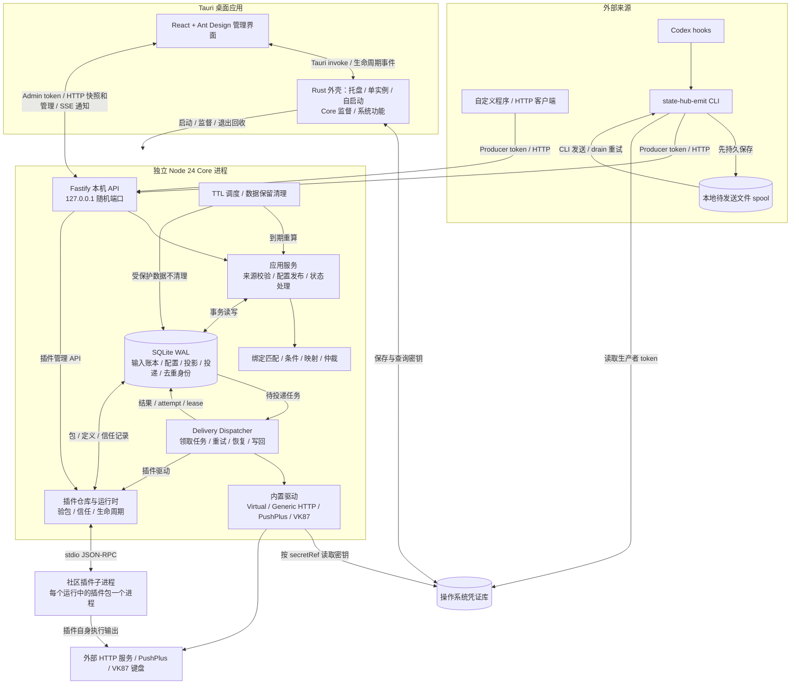
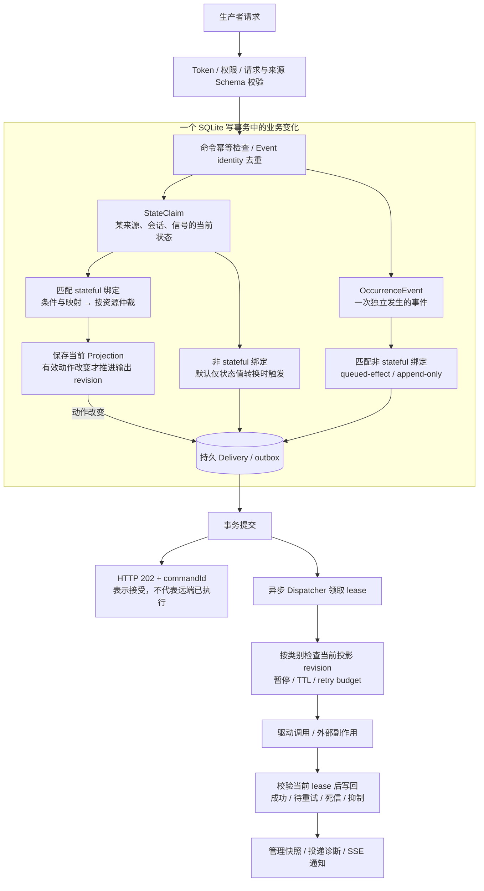
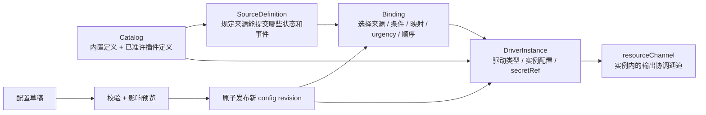

# 当前代码架构图

> 核对日期：2026-10-12。基线：`f9abefe`，并包含当前工作树中尚未提交的 #23/#24 修改。
> 本文描述代码现状，供项目负责人对照最初设想；不是验收通过声明，也不替代规范性文档 [ARCHITECTURE.md](ARCHITECTURE.md)。

## 1. 整体结构：谁负责什么

读图要点：

- **Core 是业务中心。** 来源提交事实，绑定决定事实如何影响输出。桌面界面负责配置和观察，关闭窗口会隐藏到托盘。
- **界面直接访问 Core 的本机 HTTP API。** Rust 提供连接信息、管理会话和生命周期事件；普通配置请求不经过 Rust 转发。托盘暂停/恢复是 Rust 直接调用 Core 的例外入口。
- **内置驱动运行在 Core 内。** 社区插件另起进程；这种隔离用于限制故障传播，不是防恶意代码的操作系统沙箱。
- **SQLite 是持久事实来源。** SSE 用于通知界面刷新；界面重连先取快照，不靠积累 SSE 消息恢复全部状态。
- **spool 由 CLI 发送。** 当前 Core 没有自动扫描并消费 spool 的后台任务；失败文件后续需要执行 CLI 的 `drain`。
- Virtual 驱动产生本地可观察结果；图中的外部目标对应其余驱动，不表示 Virtual 也访问网络或硬件。

## 2. 输入如何变成输出

这是新增有效命令的主要路径；重复命令会返回已有接受结果，未产生动作的命令也可完成事务。HTTP 层校验与事务内业务校验分工，不能把图理解为全部网络鉴权都在 SQLite 事务内。

三种动作的差别：

- **stateful：当前应显示什么。** 以 DriverInstance + resourceChannel 为仲裁单位。比较 urgency、绑定 order、服务端 revision；相同动作合并贡献者。输入可有很多条，每个资源保留当前投影。TTL、确认、配置发布和暂停/恢复也会触发重算。
- **queued-effect：一次性动作。** 进入异步投递路径，恢复时不会简单补发旧效果。
- **append-only：每次事件都需要记录或通知。** 使用持久 identity、批次、重试预算、TTL 和死信；允许远端成功但本地尚未确认时的至少一次重投。

外部调用不在 SQLite 事务内，因此不能把这套结构理解为“远端副作用恰好一次”。Generic HTTP 的 stateful 请求携带 projectionRevision；要防止已经发出的旧请求在远端迟到覆盖新状态，接收端也必须执行 revision 校验。

## 3. 配置与扩展

- 状态值由来源 Schema 定义；平台没有把所有来源固定成“工作中、待决策、已完成”三态，这只是 Codex 来源的具体定义。
- 配置发布会按当前 claims 重算 stateful 输出，不重放过去的事件。回滚创建新的配置版本。
- 插件包提供版本化定义，宿主用 Schema 渲染配置；插件不注入任意 React 页面。
- 插件安装、信任、启停、升级、卸载已经有管理 API；当前桌面主要是来源、配置和运行态管理，不能把 API 覆盖等同于完整的插件商店界面。

## 4. 代码位置

- [Core 启动与组装](../apps/core/src/main.ts)：数据库、插件、驱动、调度器、本机服务及关机顺序。
- [HTTP 入口](../apps/core/src/server.ts) 与 [业务服务](../apps/core/src/service.ts)：生产者命令、管理 API、事务、配置、投影与 outbox。
- [领域计算](../packages/domain/src/index.ts)：绑定匹配、安全映射、仲裁和身份编码。
- [数据库](../apps/core/src/database.ts)、[投递调度](../apps/core/src/dispatcher.ts)、[TTL](../apps/core/src/ttl-scheduler.ts)、[保留策略](../apps/core/src/retention.ts)。
- [内置定义](../apps/core/src/builtins.ts) 与 [驱动实现](../apps/core/src/drivers.ts)。
- [插件仓库](../apps/core/src/plugin-repository.ts)、[插件运行时](../apps/core/src/plugin-runtime.ts)、[进程通信](../apps/core/src/plugin-host.ts)。
- [桌面入口](../apps/desktop/src/App.tsx)、[HTTP 客户端](../apps/desktop/src/api.ts)、[重连逻辑](../apps/desktop/src/connection-loop.ts)。
- [Rust 外壳](../apps/desktop/src-tauri/src/lib.rs) 与 [Core 监督](../apps/desktop/src-tauri/src/supervisor.rs)。
- [CLI 与 spool](../packages/emit-cli/src/main.ts)、[Codex hook](../packages/emit-cli/src/codex-hook.ts)。
- `packages/protocol`、`packages/sdk`、`packages/plugin-kit` 是共享协议、通信与插件工具库，不是另行启动的常驻服务。

## 5. 本轮保留的职责边界

1. 来源只提交事实，Core 统一决定输出；来源不直接占有设备。
2. 状态与事件分开：当前状态参与仲裁，一次性事件走独立效果投递。
3. 一个设备实例可以拥有多个 resourceChannel；竞争范围是“实例 + 通道”。
4. 桌面界面直接连接 Core；Rust 负责系统功能和 Core 进程监督。
5. 插件独立进程提供故障隔离，插件仍需可信。

Rust 指 Tauri 的原生外壳，负责系统集成、凭据库和进程监督；用户看到的前端界面由 React/Ant Design 实现。项目负责人确认架构职责后，本轮修复保持这些边界。系统仍按规格保持本地优先，没有云端调度中心、跨设备同步或 LAN 入站服务。

DSH 当前只有 `dshStateToClaim` 映射函数，仓库搜索没有发现调用点；不能据此认为已有完整 DSH 端到端接入。

## 6. 实现与验收状态不要混淆

- 图覆盖当前工作树；桌面启动测量、条件启用 updater、打包与发布辅助改动中有尚未提交的 #23/#24 成果。
- updater 的代码存在不代表正式升级渠道、签名、公证和跨平台发行已经就绪。
- 2026-10-12 绘图后的修复已处理干净环境构建顺序、状态投影性能及真实桌面跨域连接与生命周期；逐项证据和最终门禁以 [ISSUE_PROGRESS.md](ISSUE_PROGRESS.md) 与施工日志为准。
- 架构图本身不构成验收证据；#23/#24 的启动性能、其他平台安装及正式签名仍需独立验证。
